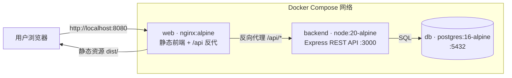
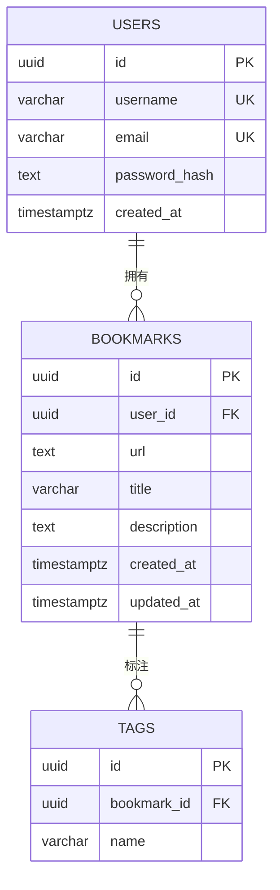

# linkmark · 架构契约（Architecture Contract）

> 极简书签管理器。本文档是四个角色（架构师 / 后端开发 / 前端开发 / 运维）
> 协同实现的**唯一权威契约**：技术栈、数据库 Schema、API 接口、目录与端口约定。
> 任何角色若发现契约有歧义或需要变更，先按本文档执行，并把变更请求反馈给架构师统一修订，
> 不要各自私下改动 `docs/` 与 `db/init.sql`。

## 1. 目标与范围

用户可注册 / 登录，收藏网页链接，给书签打标签，按标签与关键词搜索自己的书签。
「极简」是硬约束：无分页、无标签管理页、无分享、无第三方登录、无 ORM、无 TypeScript。

**非目标（本版不做）**：分页、标签重命名/合并、书签导入导出、公开书签、协同、刷新令牌。

## 2. 技术栈契约

| 层 | 技术 | 版本 / 镜像 | 说明 |
|---|---|---|---|
| 前端 | React + Vite | React 18 / Vite 5 | 纯 JSX，无 TS；构建产物为静态 `dist/` |
| 前端路由 | react-router-dom | 6 | 仅需 `/login`、`/register`、`/` 三个路由 |
| 后端 | Node.js + Express | Node 20 / Express 4 | REST，无 ORM，用 `pg` 写原生 SQL |
| 认证 | jsonwebtoken + bcryptjs | JWT HS256 | 无状态，Bearer Token |
| 数据库 | PostgreSQL | `postgres:16-alpine` | 独立服务，非 SQLite |
| Web / 反代 | nginx | `nginx:alpine` | 托管前端静态产物 + 反向代理 `/api` |
| 编排 | Docker Compose | v2 | `docker compose up --build` 一键拉起 |

**依赖清单（后端）**：`express@4`、`pg@8`、`bcryptjs@2`、`jsonwebtoken@9`、`dotenv@16`。
生产不需要 `cors`：nginx 把 `/api` 反代到后端，前后端同源；开发期由 Vite proxy 解决跨域。

## 3. 系统架构与部署



- 仅 `web` 对宿主机暴露端口（`${WEB_PORT:-8080}:80`）。
- `backend` 与 `db` 只在 Compose 内部网络可达，不对宿主机暴露。
- 浏览器永远同源访问 `/` 与 `/api`，前端 `api.js` 的 baseURL 固定为 `/api`（不要写死后端地址）。

## 4. 数据库设计

### 4.1 设计决策：为什么是三张表

任务要求「users、bookmarks、tags 三张表，关系清晰」。书签与标签本质是**多对多**，
规范化做法会引入第 4 张 `bookmark_tags` 关联表，与「三张表」冲突。本契约采用：

> **标签作为书签的子行**：`tags.bookmark_id` 外键指向 `bookmarks`。
> 关系链 `users 1─N bookmarks 1─N tags`，恰好三张表，层级清晰。

取舍：同名标签会在多个书签间重复存储（无共享标签实体）。换来的是三表、无 JOIN 关联表、
写入即 `DELETE + INSERT` 子行的极简模型；「按标签筛选」用 `JOIN tags ... WHERE t.name = $n`，
「标签列表」用 `SELECT DISTINCT name`。对单用户书签场景完全够用。
（若未来需要全局标签管理，再演进为共享 tags + 关联表，由架构师统一修订。）

### 4.2 ERD



### 4.3 表结构

**users**：`id`(PK, uuid)、`username`(UNIQUE, ≤32)、`email`(UNIQUE, ≤255)、
`password_hash`(bcrypt)、`created_at`。

**bookmarks**：`id`(PK)、`user_id`(FK→users, ON DELETE CASCADE)、`url`、`title`(≤255)、
`description`(默认 '')、`created_at`、`updated_at`。索引 `(user_id, created_at DESC)`。

**tags**：`id`(PK)、`bookmark_id`(FK→bookmarks, ON DELETE CASCADE)、`name`(≤32)，
`UNIQUE(bookmark_id, name)`，索引 `(name)`。

**完整 DDL** 见 `db/init.sql`（唯一权威，运维挂载到 `db` 容器首次启动执行）。
后端不自动建表、不修改 Schema；`updated_at` 由后端在 UPDATE 语句中显式 `now()` 维护。

### 4.4 ID 与时间

- 主键统一 `UUID DEFAULT gen_random_uuid()`（PG13+ 内置，`pgcrypto` 兜底）；JSON 中即字符串。
- 时间统一 `TIMESTAMPTZ`，API 输出 ISO-8601 UTC（如 `2026-11-12T12:00:00.000Z`）。

## 5. API 契约

### 5.1 通用约定

- Base：`/api`；所有请求 / 响应 `Content-Type: application/json`。
- 认证：除注册 / 登录外，所有端点需 `Authorization: Bearer <token>`。
  JWT 由 `POST /api/auth/login|register` 返回，payload `{ sub: user.id }`，HS256，有效期 7d。
- **所有权不变量（安全红线）**：所有书签 / 标签查询必须带 `user_id = <JWT 的 sub>`；
  绝不信任客户端传来的 `user_id`。查询他人资源一律返回 `404`（不返回 403，避免泄露存在性）。
- 统一错误体：`{ "error": { "code": "STRING", "message": "可读信息" } }`。
- 状态码：`200` 读取/更新、`201` 创建、`204` 删除（无响应体）、
  `400` 校验失败、`401` 未认证/凭据错误、`404` 不存在、`409` 唯一键冲突、`500` 服务端错误。

### 5.2 数据模型（JSON）

```json
// User
{ "id": "uuid", "username": "alice", "email": "a@b.com", "created_at": "ISO8601" }

// Bookmark（tags 为字符串数组，返回时按 name 升序）
{
  "id": "uuid",
  "url": "https://example.com",
  "title": "Example",
  "description": "",
  "tags": ["work", "reading"],
  "created_at": "ISO8601",
  "updated_at": "ISO8601"
}
```

### 5.3 端点清单

| 方法 | 路径 | 认证 | 说明 |
|---|---|---|---|
| POST | `/api/auth/register` | 否 | 注册，返回 token + user |
| POST | `/api/auth/login` | 否 | 登录，返回 token + user |
| GET | `/api/auth/me` | 是 | 当前用户 |
| GET | `/api/bookmarks` | 是 | 我的书签列表，支持筛选 |
| GET | `/api/bookmarks/:id` | 是 | 单个书签 |
| POST | `/api/bookmarks` | 是 | 新建书签 |
| PUT | `/api/bookmarks/:id` | 是 | 全量更新书签（含 tags 替换） |
| DELETE | `/api/bookmarks/:id` | 是 | 删除书签 |
| GET | `/api/tags` | 是 | 我用过的标签名列表（去重） |

### 5.4 端点明细

**POST /api/auth/register**
- Body：`{ "username": "3-32位 [A-Za-z0-9_]", "email": "合法邮箱", "password": "≥8位" }`
- `201` → `{ "token": "...", "user": User }`
- `409` → `EMAIL_TAKEN` / `USERNAME_TAKEN`；`400` → `VALIDATION_ERROR`

**POST /api/auth/login**
- Body：`{ "email": "...", "password": "..." }`
- `200` → `{ "token": "...", "user": User }`；`401` → `INVALID_CREDENTIALS`

**GET /api/auth/me** → `200 { "user": User }`

**GET /api/bookmarks** — 列表 + 筛选
- Query：`q`（关键词，可选）、`tag`（标签名，可选）；**两者同时出现为 AND**。
- `q`：`ILIKE '%q%'` 匹配 `title / url / description`（三字段 OR）。
- `tag`：`JOIN tags` 命中 `t.name = tag`，用 `DISTINCT` 去重。
- 结果按 `created_at DESC, id DESC` 排序；无分页。
- `200` → `{ "bookmarks": [Bookmark, ...] }`（空结果返回 `[]`，不是 404）。

**GET /api/bookmarks/:id** → `200 { "bookmark": Bookmark }`；不存在 / 非本人 → `404 NOT_FOUND`

**POST /api/bookmarks**
- Body：`{ "url": "http(s)://...", "title": "≤255 非空", "description": "≤2000 可选", "tags": ["a","b"] }`
- `201` → `{ "bookmark": Bookmark }`；`400 VALIDATION_ERROR`（url 非法 / title 空 / tags 超限）

**PUT /api/bookmarks/:id**
- Body 同上（全量替换）；`tags` 采用「先删该书签全部 tags，再插入新集合」的事务写法。
- `200` → `{ "bookmark": Bookmark }`，同时 `updated_at = now()`；`404` 不存在 / 非本人

**DELETE /api/bookmarks/:id** → `204`（级联删除其 tags）；`404` 不存在 / 非本人

**GET /api/tags** → `200 { "tags": ["work", ...] }`（`SELECT DISTINCT name ... ORDER BY name`）

### 5.5 校验与规范化规则（后端统一实现）

- `url`：`new URL()` 可解析且协议为 `http:` / `https:`。
- `tags`：数组，元素 `trim` + 转小写 + 去空 + 去重，单个 ≤32 字符，单个书签最多 20 个。
- `q` / `tag`：trim 后使用；`tag` 按规范化后的名字精确匹配（大小写不敏感）。

### 5.6 错误码

`VALIDATION_ERROR`(400)、`UNAUTHORIZED`(401)、`INVALID_CREDENTIALS`(401)、
`NOT_FOUND`(404)、`EMAIL_TAKEN`/`USERNAME_TAKEN`(409)、`INTERNAL`(500)。

## 6. 前端契约

| 路由 | 页面 | 关键调用 |
|---|---|---|
| `/login` | 登录表单（email + password） | `POST /api/auth/login` |
| `/register` | 注册表单（username + email + password） | `POST /api/auth/register` |
| `/` | 书签列表（受保护） | `GET /api/bookmarks`、`GET /api/tags`、增删改 |

- 登录 / 注册成功后把 `token` 存入 `localStorage`（键 `linkmark_token`），跳 `/`。
- `api.js`：baseURL `'/api'`，自动附加 `Authorization: Bearer`，统一解析 JSON、非 2xx 抛错。
- **任意接口返回 401** → 清除 token → 重定向 `/login`。
- 列表页：顶部关键词搜索框（`q`）、标签筛选（`tag`，标签来自 `GET /api/tags`）、
  「添加书签」按钮；每条书签支持编辑 / 删除。
- 添加 / 编辑表单字段：`url`、`title`、`description`、`tags`（逗号分隔输入，提交时转数组）。
- 未登录访问 `/` 直接重定向 `/login`。

## 7. 运维契约（Docker Compose）

**三服务**：`db`、`backend`、`web`，全部接入同一 Compose 网络。

| 服务 | 镜像 / 构建 | 关键配置 |
|---|---|---|
| `db` | `postgres:16-alpine` | env `POSTGRES_USER/PASSWORD/DB`；挂载 `./db/init.sql` → `/docker-entrypoint-initdb.d/`；命名卷持久化；`pg_isready` healthcheck |
| `backend` | build `./backend`（node:20-alpine） | env `DATABASE_URL=postgres://...@db:5432/...`、`JWT_SECRET`、`JWT_EXPIRES_IN=7d`、`PORT=3000`；`depends_on: db(service_healthy)` |
| `web` | build `./frontend`（多阶段：node 构建 dist → nginx:alpine 托管） | 镜像内置 nginx 配置：静态 `dist/` + `location /api` 反代到 `http://backend:3000`；`ports: ${WEB_PORT:-8080}:80`；`depends_on: backend` |

- 前端 Dockerfile 多阶段产出**静态构建产物**交给 nginx，满足「前端构建产物」要求。
- 根 `.env.example` 列出：`POSTGRES_USER`、`POSTGRES_PASSWORD`、`POSTGRES_DB`、
  `JWT_SECRET`、`JWT_EXPIRES_IN`、`WEB_PORT`。
- 一键启动：`docker compose up --build`；浏览器访问 `http://localhost:${WEB_PORT:-8080}`。
- `db` 的 init 脚本仅在数据卷首次为空时执行（Postgres 官方镜像行为）。

## 8. 仓库目录布局与角色边界

```
linkmark/
├── docs/ARCHITECTURE.md      # 架构师 · 本契约
├── db/init.sql               # 架构师 · 唯一权威 DDL
├── backend/                  # 后端开发 · Express API + Dockerfile
├── frontend/                 # 前端开发 · React/Vite + 多阶段 Dockerfile（内置 nginx 配置）
├── docker-compose.yml        # 运维 · 三服务编排
└── .env.example              # 运维 · 环境变量样例
```

**边界**：各角色只写自己负责的目录；不得修改 `docs/`、`db/init.sql` 及他人目录。
契约变更由架构师统一更新并通知全员。

## 9. 验收清单

1. 注册 → 登录拿到 token → `GET /api/auth/me` 返回本人。
2. 新建带标签书签 → 列表可见 → 按 `q` 关键词命中 title/url/description → 按 `tag` 命中。
3. `q` + `tag` 同时为 AND；他人书签 / 他人 id 一律不可见（404）。
4. 编辑（含 tags 全量替换）、删除（级联清 tags）生效。
5. 前端三页可用；未登录跳转登录；401 自动登出。
6. `docker compose up --build` 一键拉起，浏览器 `http://localhost:8080` 全链路可用。
